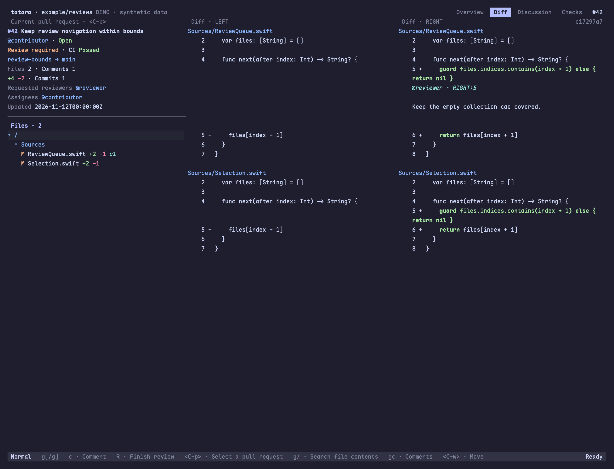

# tatara.nvim

Review GitHub pull requests with native Neovim windows, source buffers and your existing editor configuration. A persistent Swift backend handles `gh`, immutable revisions, difftastic, caching and validated review writes.

Tatara keeps its review workspace and interaction flow on native Neovim buffers and windows. `tatara` opens that workspace from the current directory and uses your editor configuration; it requires Neovim. The UI is not a generic buffer list or a separate terminal renderer.



## Requirements

- Neovim nightly, currently 0.13+, with your preferred editor configuration.
- macOS 15+, Xcode 27.2 / Swift 6.4.2 for the backend build.
- `git`, `gh` and `difft` on PATH. Authenticate `gh` for the repository's host.

## Install

Choose an installation method. All methods use the Swift backend built from source.

**vim.pack** with PackSpec support in current Neovim nightly

```lua
vim.pack.add({ { src = 'https://github.com/PangMo5/tatara.nvim', version = 'main' } })
```

**lazy.nvim**

```lua
{ 'PangMo5/tatara.nvim', branch = 'main', cmd = 'Tatara', opts = {} }
```

Both managers build the backend on install and update. Open `:Tatara demo` to try the workspace, or run `:Tatara` from a GitHub repository to start a review.

**Terminal launcher and native start package**

```sh
git clone https://github.com/PangMo5/tatara.nvim.git
cd tatara.nvim
swift Scripts/Tatara.swift build release
swift Scripts/Tatara.swift install-local
```

Add `~/.local/share/tatara/local/bin` to PATH. The installer also makes `:Tatara` available on the next Neovim startup.

See the [installation guide](docs/INSTALL.md) for toolchain selection, updates, manual plugin loading, and `:checkhealth tatara`.

## Open a review

With the terminal launcher installed, run these commands from a repository.

```sh
cd /path/to/repository
# Opens this branch's PR or lets you choose a PR when the branch has none.
tatara
# Open a particular PR in this repository.
tatara --number 123
# Synthetic data; no forge writes.
tatara --demo
# Detailed repository selector, including additional pages and forge queries.
tatara --list
tatara --issues
# Optional editor overrides; the default inherits your configuration.
tatara --language ko --files-view list --sidebar-width 40 --wrap off
```

With any installation method, `nvim -c Tatara` opens the current branch's PR or the repository's PR selector when the branch has no PR. Use `:Tatara 123` to open a specified PR and `:Tatara list` or `:Tatara issues` for detailed selectors with search, filters, presets and pagination. Ctrl-p is the quick switcher. Startup commands wait for `VimEnter` callbacks so session restoration runs before the review tab opens.

## Native editor behavior

- Files, the PR overview and the two diff sides are real Neovim windows. Use your normal window navigation; Tatara installs no global navigation mappings.
- Difftastic owns structural alignment and changed-token emphasis by default. Native extmarks, virtual filler and folds display that alignment in immutable file buffers; the line-diff engine does not replace it. Set `diff = { engine = 'native' }` to explicitly choose Neovim's diff engine.
- The root opens a combined structural diff. Narrow file views show both source sides in a unified projection. Every source row retains its immutable path, side and line for comments; Enter opens the corresponding ordinary file buffer for your configured LSP. Projections are derived review views and are not attached to a language server as fictitious files.
- The PR summary stays above Files, with semantic colors for status, branches, directories and change counts. Moving the Files cursor previews that file or directory without moving focus; Enter opens the true source buffer. Paths stick in the content winbar. Switch Overview/Diff/Discussion/Checks with `g[` / `g]`, clickable headings, or `<LocalLeader>1` / `2` / `3` / `4`.
- The head source uses a real, detached immutable worktree path. Existing FileType, BufRead, LspAttach, Tree-sitter and diagnostic configuration continue to work normally. Base sources use their own immutable worktree paths too; neither revision starts a Tatara-owned language server.
- Native `/`, `n`/`N`, motions, folds and jumplist behavior remain Neovim's responsibility in source buffers. Files `/` opens a path picker, and `g/` searches immutable PR contents.
- With MiniPick already configured, Files `/` uses its existing layout, mappings and preview UI with asynchronous FFF ranking and exact Unicode match highlights. Other editors use their standard UI provider; a custom `picker` can implement the same cancellable query contract. Content search offers plain text, regex and fuzzy modes.
- Initial source focus goes to the first changed line; exact content-search targets take priority.
- Tatara starts no LSP servers, changes no LSP capabilities and does not configure diagnostics. Define and enable your servers normally with `vim.lsp.config` / `vim.lsp.enable`. Semantic features still depend on your server's build metadata and indexing.
- Xcode workspace/scheme selection and BSP configuration remain user-owned. Use an explicit asynchronous `prepare(context, done)` hook for build-system setup before buffers open. `User TataraWorkspaceReady` also exposes the checkout identity for observers. No project-authored setup is executed automatically.

## Review workflow

Select a file and press Enter. Source-buffer `c` opens a Markdown editing buffer near the source anchor; visual `c` selects a range. `:write` saves directly to the pending review and returns to source. `<LocalLeader>p` or `:Tatara post_comment` previews a single published comment without including unrelated drafts. Insert-mode completion keys remain native; Ctrl-s is a save shortcut only in Normal mode.

`R` opens the review workspace directly: summary, visible Comment/Approve/Request changes choices, and pending comments. Select the review event with g1/g2/g3 or the header controls, navigate ordinary windows with Ctrl-w, and write the summary to preview. Enter edits a pending comment, d removes it and o opens its source. Preview/Back retains text and event selection. Published writes require an explicit confirmation of the concrete preview.

Comments are read before mutation actions. Drafts and previews are bound to the reviewed immutable head. Refreshing to another revision invalidates old write previews. Changing the active `gh` account invalidates confirmation. Network writes are never retried automatically.

`:Tatara drafts` (`gP`) focuses pending comments inside review completion. Switching PRs retains drafts for the same reviewed revision. `gc` opens the contextual thread reader: r replies, e edits, d previews deletion, a chooses a reaction and s resolves/reopens when freshly permitted. The reader also supports copying and permalinks. Space toggles a file's reviewed marker. `:Tatara checks` and `:Tatara discussion` show the other review sections.

Saved inline comments, review summaries and file/hunk progress are restored when reopening the same account, repository, PR, merge base and head. `:write` is the save boundary; unfinished composer text stays in memory until you save it. Older revisions remain separate and are never silently reanchored. `:Tatara saved_reviews` shows saved revisions and offers explicit removal.

Use `]h` / `[h` for forge hunks and `]f` / `[f` for files. `gH` marks the current hunk reviewed; Space marks a file. `<LocalLeader>h` hides reviewed files. `<LocalLeader>f` opens include/exclude Neovim regex filters, shared by the tree, continuous diff and search results.

`gs` in Normal or Visual mode opens a suggestion prefilled from immutable new-side source. `<LocalLeader>C` or `:Tatara file_comment` composes a file-level comment with its own single-comment preview; it is not added to a batched inline review. `:Tatara export` and `:Tatara export json` open ordinary writable buffers, so native `:write PATH` saves the export. `:Tatara export clipboard` copies Markdown through the user's clipboard provider. Exporting does not publish anything.

Composer bodies remain available when reopening the same composer during the review session.

Default mappings are buffer-local and configurable; existing user buffer mappings take precedence. Set an action to `false` to disable it. Native LSP mappings such as `gd`, `gr` and `K` are not replaced.

Use `:checkhealth tatara` to inspect runtime dependencies. Set `materialize = false` in `open()` for an explicit source-only view without native file-backed LSP attachment.

See [workspace design and Neovim adaptations](docs/NEOVIM_UX.md), [capability inventory and acceptance limits](docs/NEOVIM_PARITY.md), [configuration and extension points](docs/EXTENDING.md), [the backend protocol](docs/PROTOCOL.md), and [development](CONTRIBUTING.md).

## Support development

If you find tatara.nvim useful, you can support its development with a coffee.

<a href="https://buymeacoffee.com/pangmo5"></a>
